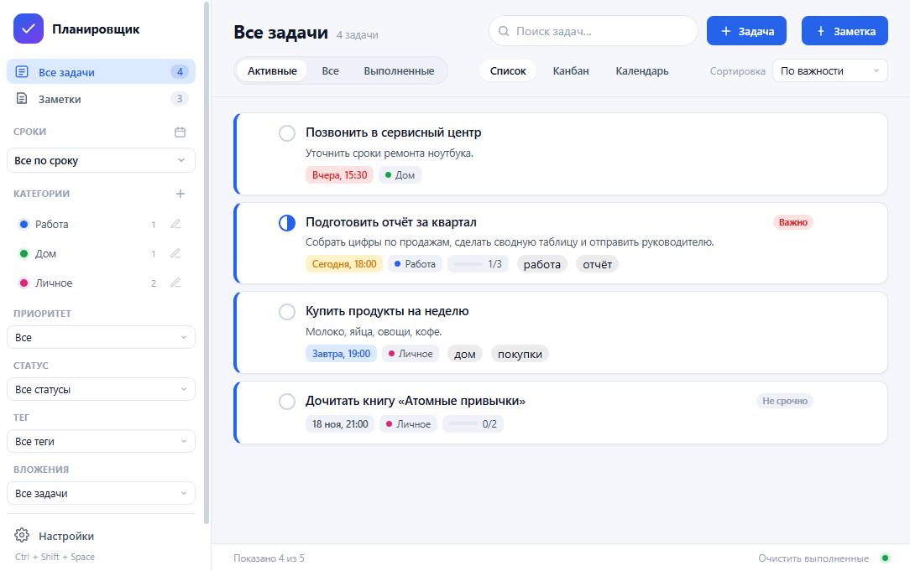
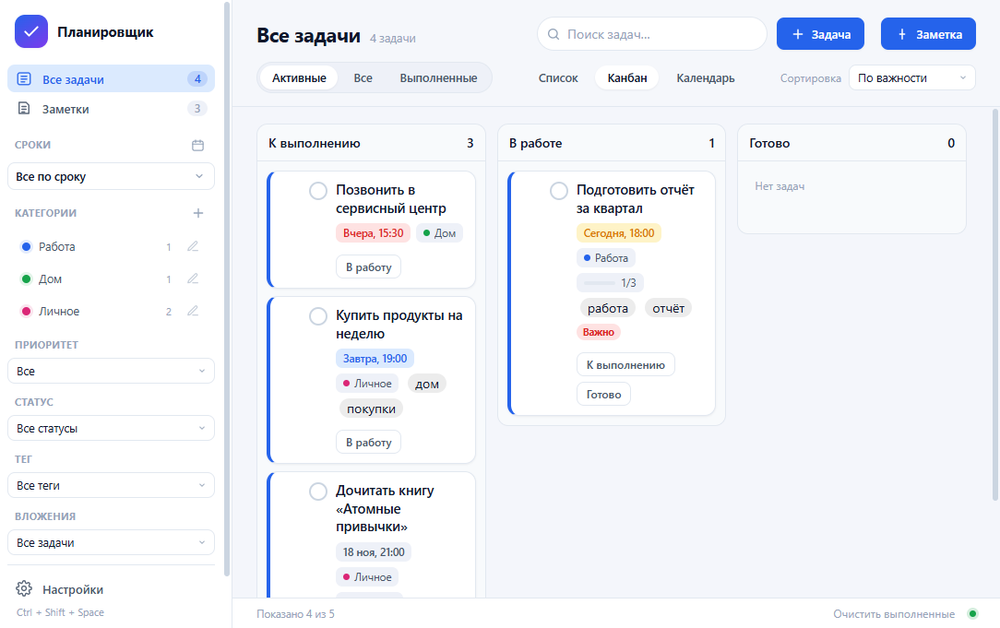
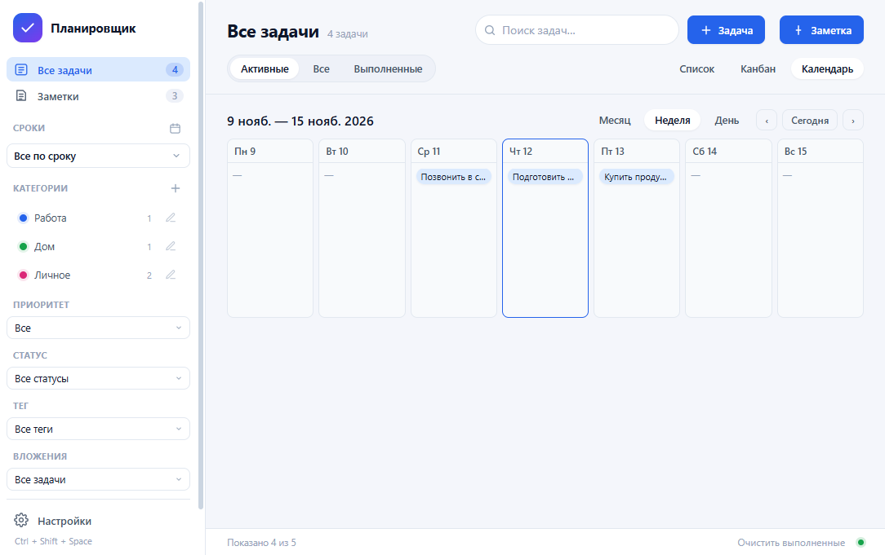
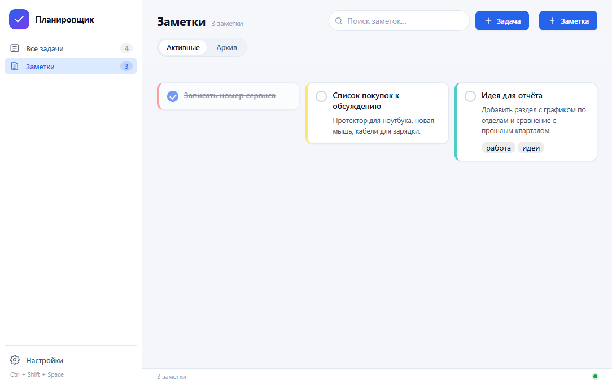
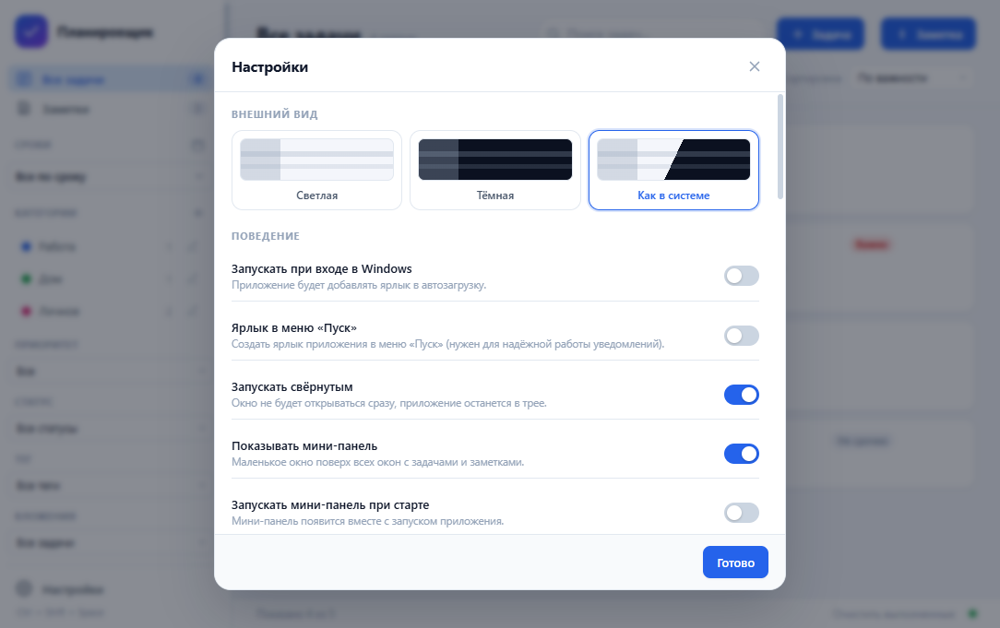

# Планировщик


Локальный планировщик задач и заметок для Windows. Без облака, регистрации и сбора данных: всё хранится локально на вашем компьютере (JSON + папка вложений). Версия 2.0 развивает локальный функционал 1.x: представления, теги, умные списки, вложения, история/статистика и усиленная работа с резервными копиями.

## Содержание

- [Быстрый старт](#быстрый-старт)
- [Возможности](#возможности)
- [Установка](#установка)
- [Скриншоты](#скриншоты)
- [Горячие клавиши](#горячие-клавиши)
- [Где хранятся данные](#где-хранятся-данные)
- [Резервное копирование и перенос на другой компьютер](#резервное-копирование-и-перенос-на-другой-компьютер)
- [Переменные окружения](#переменные-окружения)
- [Безопасность и конфиденциальность](#безопасность-и-конфиденциальность)
- [Разработка](#разработка)
- [Сборка](#сборка)
- [Структура проекта](#структура-проекта)
- [Устранение неполадок](#устранение-неполадок)
- [Часто задаваемые вопросы](#часто-задаваемые-вопросы)
- [Ограничения версии 1.0](#ограничения-версии-10)
- [Лицензия](#лицензия)

## Быстрый старт

1. Установите приложение или запустите портативную версию (актуальные артефакты — в [Releases](https://github.com/lifemy21rus/my_tasks/releases)).
2. При первом запуске приложение свернётся в трей. Нажмите на иконку в области уведомлений или нажмите `Ctrl+Shift+Space`, чтобы открыть окно.
3. Создайте первую задачу (`Ctrl+N`) или заметку.
4. При обновлении с 1.x данные автоматически мигрируются в схему v2; перед миграцией создаётся защитная резервная копия (см. `docs/MIGRATION-2.0.md`).

## Возможности

### Задачи и заметки
- задачи с названием, описанием, сроком, приоритетом, категорией, цветом, временем (оценка/факт), статусом (`к выполнению` / `в работе` / `готово`);
- подзадачи с вложенностью до двух уровней и инвариантами выполнения родителя/потомков;
- напоминания Windows (несколько на задачу), отложение напоминаний, повторяющиеся задачи;
- заметки с содержимым, цветом, тегами, архивом;
- вложения файлов к задачам и заметкам (локальное хранилище в папке данных): файл можно прикрепить ещё до сохранения, в списке видны имя и размер, вложение открывается двойным кликом по имени в карточке или кнопкой «показать в папке».

### Представления и навигация
- виды: **Список**, **Канбан**, **Календарь** (месяц) с навигацией;
- drag-and-drop: перенос задач между колонками/смена статуса и порядка, изменение срока в календаре, ручной порядок в списке (сортировка «По порядку»);
- фильтры и поиск: приоритет, статус, тег, срок/представления, поиск по задачам/заметкам/тегам;
- **умные списки**: сохранение и применение наборов критериев просмотра/фильтров (кнопка «+» в разделе «Списки» сайдбара);
- теги: ввод в задачах/заметках, фильтр по тегу, справочник тегов в настройках (добавление/переименование/удаление) и подсказки.

### Надёжность и данные
- локальное хранение без облака/регистрации/телеметрии;
- миграция данных `1.x → 2.0` с pre-migration резервной копией;
- резервные копии JSON + снимки папки `attachments/`, восстановление из списка копий в настройках, ручной запуск GC вложений;
- импорт/экспорт JSON (v1/v2), экспорт CSV;
- опциональное шифрование `data.json` (AES-256-GCM, пароль в `MYTASKS_DATA_PASSWORD`).

### Удобство
- мини-панель и работа в трее, глобальная горячая клавиша (настраивается), автозапуск;
- статистика и лента последних действий в настройках;
- отмена удаления задачи/заметки сразу после действия (undo);
- светлая/тёмная/системная темы, русский интерфейс.

## Установка

### Системные требования

- Windows 10 или Windows 11 (x64).
- Для портативной версии установка не требуется.

### Обычная установка

1. Запустите `MyTasks-Setup-1.0.3.exe` и следуйте мастеру установки.
2. Приложение появится в меню «Пуск» и на рабочем столе.
3. При первом запуске приложение работает в трее. Нажмите на иконку в трее или используйте `Ctrl+Shift+Space`, чтобы открыть окно.

Портативная версия `MyTasks-1.0.3-portable.exe` не требует установки. Учтите: без ярлыка в меню «Пуск» уведомления Windows могут отображаться менее надёжно — система привязывает их к приложению через ярлык.

### Удаление

1. Удалите приложение через «Параметры → Приложения → Установленные приложения» или классическую панель «Программы и компоненты».
2. Данные (`%APPDATA%\MyTasks\data.json` и резервные копии) **не удаляются автоматически** при деинсталляции. Если нужно полностью очистить следы приложения, удалите папку `%APPDATA%\MyTasks\` вручную.

## Скриншоты

Актуальные снимки интерфейса 2.0 лежат в `docs/screenshots/` (светлая и тёмная темы):

```markdown





```

Переснять набор автоматически (демо-профиль, обе темы):

```bash
npm run shots
```

Состав снимков и порядок файлов — в [`docs/screenshots/README.md`](docs/screenshots/README.md).


## Горячие клавиши

| Клавиши | Действие |
| --- | --- |
| `Ctrl+Shift+Space` | Показать/скрыть окно (глобально) |
| `Ctrl+N` | Новая задача (в мини-панели — новая заметка на вкладке «Заметки») |
| `Ctrl+F` | Поиск |
| `Ctrl+Enter` | Сохранить задачу в открытом редакторе |
| `Esc` | Закрыть окно/меню |

Горячую клавишу можно изменить в настройках. Поддерживаются `Ctrl`, `Alt`, `Shift` и клавиши `A–Z`, `0–9`, `F1–F12`, `Space`.

### Мини-панель (расширенные настройки)
В разделе «Настройки» можно:
- включить запуск мини-панели вместе с приложением («Запускать мини-панель при старте»);
- выбрать, какие вкладки показывать в мини-панели: только задачи, только заметки или обе вместе.

### Архив заметок
При удалении заметки она перемещается в архив вместо безвозвратного удаления. Во вкладке «Заметки» можно переключаться между «Активными» и «Архивом», а из архива восстановить любую заметку обратно.

## Где хранятся данные

```text
%APPDATA%\MyTasks\data.json
%APPDATA%\MyTasks\attachments\
%APPDATA%\MyTasks\backups\
```

- запись `data.json` атомарная: сначала временный файл, затем переименование;
- при повреждении `data.json` приложение пытается восстановиться из последней резервной копии;
- перед миграцией 1.x→2.0, импортом и восстановлением создаются защитные резервные копии;
- хранятся последние обычные копии (с ротацией), а защитные pre-migration/before-* копии сохраняются отдельно;
- резервные копии включают JSON данных и (при наличии) снимок папки `attachments/`;
- папку данных можно открыть из настроек: «Данные → Открыть папку»;
- опциональное шифрование `data.json` (AES-256-GCM) включается в настройках, пароль задаётся через `MYTASKS_DATA_PASSWORD`.
- **⚠️ Важно:** без пароля зашифрованные данные восстановить невозможно. Текущее шифрование применяется к `data.json`; файлы вложений хранятся отдельно (см. `docs/SECURITY-DATA-v2.md`).

### Резервное копирование и перенос на другой компьютер

1. Для переноса скопируйте всю папку `%APPDATA%\MyTasks\` (включая `attachments\` и `backups\`).
2. На новом компьютере установите приложение, закройте его и замените папку данных.
3. Либо восстановите нужную копию через настройки («Данные → Восстановить…» / список копий).

Примечания:
- JSON-экспорт/импорт данных теперь дополнительно переносит папку вложений рядом с файлом (`<имя_файла>.attachments`), если вложения присутствуют; при импорте такая папка подхватывается автоматически.
- Для полного переноса также можно копировать всю папку данных или использовать backup-снимки.
- Приложение не отправляет данные в сеть.

## Переменные окружения

Файл `.env` в корне проекта и системные переменные окружения позволяют переопределить поведение приложения:

| Переменная | Описание | Пример |
| --- | --- | --- |
| `MYTASKS_DATA_DIR` | Папка для `data.json` и резервных копий | `$PWD\.tmpdata` |
| `MYTASKS_SMOKE` | Путь к файлу отчёта авто-теста основного окна | `$PWD\smoke-test.json` |
| `MYTASKS_MINI_SMOKE` | Путь к файлу отчёта авто-теста мини-панели | `$PWD\smoke-mini.json` |

## Безопасность и конфиденциальность

- Все данные хранятся локально в JSON-файле на вашем компьютере.
- Приложение не подключается к интернету и не собирает телеметрию.
- Нет облачной синхронизации, регистрации и сторонних аналитических счётчиков.
- Опциональное шифрование `data.json` (AES-256-GCM) защищает файл паролем. **Без пароля данные расшифровать нельзя — храните пароль надёжно.**

## Разработка

Требования: Node.js 20+ и Windows.

```shell
npm install
npm start        # запуск приложения
npm run dev      # запуск с флагом --dev (режим разработчика)
npm test         # тесты логики хранилища и напоминаний (node:test, tests/basic.test.js)
npm run icons    # перегенерация иконок
```

Запуск с отдельной папкой данных:

```powershell
$env:MYTASKS_DATA_DIR = "$PWD\.tmpdata"
npm start
```

Демо-данные для проверки интерфейса:

```powershell
node scripts\seed-demo.js "$env:MYTASKS_DATA_DIR"
```

Авто-проверка интерфейса (приложение само собирает отчёт и закрывается):

```powershell
$env:MYTASKS_SMOKE = "$PWD\smoke-test.json"      # основное окно
$env:MYTASKS_MINI_SMOKE = "$PWD\smoke-mini.json"  # мини-панель
npm start
```

## Сборка

```powershell
npm run dist
```

Результат в `dist/`:

- `MyTasks-Setup-1.0.3.exe` — установщик NSIS;
- `MyTasks-1.0.3-portable.exe` — портативная версия.

Сборка использует `electron-builder` и конфигурацию `electron-builder.yml`.

## Структура проекта

```text
src/main/main.js            точка входа, окно, трей, хоткей, планировщик
src/main/store.js           JSON-хранилище, задачи, подзадачи, категории, заметки, резервные копии
src/main/normalizers.js     чистые функции нормализации данных (вынесены из store.js)
src/main/reminder-logic.js  чистые функции расчёта напоминаний
src/main/smoke-test.js      авто-проверка интерфейса (основное окно и мини-панель)
src/main/scheduler.js       проверка напоминаний каждые 30 секунд и после выхода из сна
src/main/notifications.js   уведомления Windows
src/main/autostart.js       ярлык в папке автозагрузки
src/main/ipc.js             IPC-обработчики
src/main/preload.js         безопасный мост window.api
src/main/mini-window.js     мини-панель (окно всегда поверх)
src/renderer/               интерфейс (HTML, CSS, JS)
src/shared/utils.js         общие функции дат и форматирования
tests/                      тесты node:test
```

## Устранение неполадок

| Проблема | Решение |
| --- | --- |
| Горячая клавиша `Ctrl+Shift+Space` не работает | Проверьте, не занята ли она другой программой. Измените комбинацию в настройках приложения. |
| Уведомления Windows не приходят | Убедитесь, что для приложения создан ярлык в меню «Пуск» (Windows привязывает уведомления к ярлыку). Проверьте параметры уведомлений в системе. |
| Портативная версия: уведомления не приходят | Создайте ярлык приложения в меню «Пуск» или используйте обычную версию с установщиком. |
| Приложение не запускается | Убедитесь, что не запущен второй экземпляр (приложение поддерживает только один экземпляр). Посмотрите в диспетчере задач. |
| `data.json` повреждён | Приложение попытается восстановиться из последней резервной копии в `%APPDATA%\MyTasks\backups\`. В крайнем случае скопируйте нужный `.json` из резервных копий вместо `data.json`. |
| Окно не появляется после перезагрузки | Проверьте, включён ли автозапуск в настройках приложения и в папке автозагрузки Windows. |
| Окно не закрывается полностью (сворачивается в трей) | По умолчанию закрытие окна свёртывает приложение в трей. Чтобы полностью выйти, используйте «Выход» из контекстного меню иконки в трее, или включите в настройках «Закрывать приложение при закрытии окна». |

## Часто задаваемые вопросы

**Есть ли версия для macOS или Linux?**  
Нет, приложение разработано специально для Windows и использует функции ОС (трей, уведомления, автозапуск).

**Можно ли синхронизировать задачи между компьютерами?**  
Встроенной синхронизации нет. Вы можете вручную копировать `%APPDATA%\MyTasks\data.json` между устройствами (см. раздел «Резервное копирование и перенос»).

**Можно ли использовать свою папку для данных?**  
Да. Установите переменную окружения `MYTASKS_DATA_DIR` или создайте файл `.env` в корне проекта (см. раздел «Переменные окружения»).

**Как сбросить все настройки и данные?**  
Удалите папку `%APPDATA%\MyTasks\` и перезапустите приложение.

## Ограничения текущей версии

Намеренно не реализованы в рамках локального сценария 2.0: облачная синхронизация, учётные записи, совместная работа и кроссплатформенность.

Дополнительно:
- папка `attachments/` не включается в JSON-экспорт/импорт (используйте backup-снимки или копирование папки данных);
- шифрование `data.json` не означает автоматического шифрования файлов вложений;
- часть возможностей (расширенные критерии smart lists, undo для всех операций, экспорт/импорт вложений единым пакетом, дополнительные представления аналитики) может развиваться в следующих итерациях.

## Лицензия

Проект распространяется под лицензией MIT (см. `package.json`).
